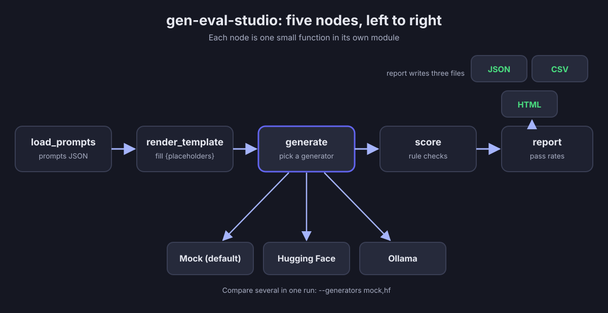

# gen-eval-studio

A small, node-style Python pipeline that runs a prompt set through text generators in bulk, scores every output with transparent rules, and writes a pass-rate report (JSON, CSV and HTML).


## Example

One prompt from `prompts/sample_prompts.json`:

```json
{
  "id": "caption_lamp",
  "template": "Write a short product image caption for a {product} in {color}. Keep it under 15 words.",
  "variables": {"product": "ceramic table lamp", "color": "sage green"},
  "checks": [
    {"type": "max_words", "value": 15},
    {"type": "must_include", "value": ["lamp"]}
  ]
}
```

Running `python3 run.py` (mock generator, so the text is fake) gives this for that prompt (taken from `results.json`, laid out for reading):

```
Prompt:  Write a short product image caption for a ceramic table lamp in sage green. Keep it under 15 words.
Output:  Presenting sage green, ceramic table lamp. Please try again.
Checks:  PASS max_words (9 words, limit is 15)
         PASS must_include (all required phrases found)
Result:  PASS
```

and the terminal summary:

```
Generator      Passed   Total   Pass rate
-------------  ------   -----   ---------
mock (fake)         3       8         38%
```

The mock generator is deliberately imperfect so the report shows both passes and fails. A committed sample run is in [`eval/`](eval/). It is mock output only; no real model was run.

## Architecture



## How it works

1. `load_prompts` reads `prompts/sample_prompts.json` (id, template, variables, checks).
2. `render_template` fills the `{placeholders}` with `str.format`, and gives a clear error if a variable is missing.
3. `generate` sends the text to one or more generators: `mock` (default), `hf` or `ollama`.
4. `score` runs each rule check (max_words, min_words, must_include, must_not_include, regex, no_digits). A prompt passes only if all its checks pass.
5. `report` writes `results.json`, `results.csv` and `report.html` to `runs/<timestamp>/`.

## Tech stack

- Python 3.9+, standard library only (urllib, json, csv, html, argparse, unittest, re)
- Hugging Face router (OpenAI-compatible) and a local Ollama server, both optional

## Run locally

```
git clone https://github.com/abhidatta-s/gen-eval-studio.git
cd gen-eval-studio
python3 run.py
```

Flags: `--prompts`, `--generators` (e.g. `mock,hf`), `--model`, `--out`. Open the `report.html` in the printed folder.

## Tests

```
python3 -m unittest discover -s tests -v
```

Covered: template rendering (including a missing variable), each scorer, mock determinism, the full pipeline in mock mode writing all three files, HTML escaping, and the `hf` generator raising a clear error without `HF_TOKEN`. No test makes a network call.

## Project structure

```
gen-eval-studio/
  run.py                  command line entry point
  gen_eval/
    prompts.py            node 1: load_prompts
    templates.py          node 2: render_template
    generators.py         node 3: generate (mock, hf, ollama)
    scorers.py            node 4: score (rule checks)
    report.py             node 5: report (JSON, CSV, HTML)
    pipeline.py           connects the nodes
  prompts/sample_prompts.json
  tests/test_gen_eval.py
  eval/                   one mock-only sample run
  assets/architecture.svg
  .env.example
```

## Adding a real model

- Hugging Face: `export HF_TOKEN=your_token`, then `python3 run.py --generators hf --model <model-name>`. The default model is `meta-llama/Llama-3.2-3B-Instruct`; whether a model is available on the free tier depends on Hugging Face and can change.
- Ollama: install it, run `ollama pull llama3.2`, then `python3 run.py --generators ollama`.
- Compare them: `python3 run.py --generators mock,hf`. Note that `--model` is passed to every real generator in the list.
- Another provider: add one function in `gen_eval/generators.py` and one `if` in `generate`.

## Why node-style

Tools like ComfyUI, Fal and Replicate workflows chain small steps, each with clear inputs and outputs. This project follows the same idea: each step is one small function, so it can be read, tested and swapped on its own.

## Design decisions and tradeoffs

- Mock is the default so anyone can run it with no keys and no network. Tradeoff: its numbers are not meaningful.
- Rule checks instead of AI grading, so every pass or fail has a reason you can explain. Tradeoff: rules cannot judge quality or tone. An optional `llm_judge` check is future work.
- Standard library only (urllib instead of requests) so nothing needs installing. Tradeoff: more verbose HTTP code.
- One failed generator call is recorded as an error row and the run continues. A missing `HF_TOKEN` stops the run early with a friendly message.
- The mock uses sha256, not Python's `hash()`, because `hash()` changes between runs.

## Honest limitations

- A prototype, built as a learning and portfolio project in October 2026.
- No real users and not deployed in production.
- No real-model results are included; only mock output was generated.
- Word counts use simple whitespace splitting.
- The Hugging Face and Ollama generators were written to their documented APIs but not run against live services here.

## License

MIT, see [LICENSE](LICENSE).
